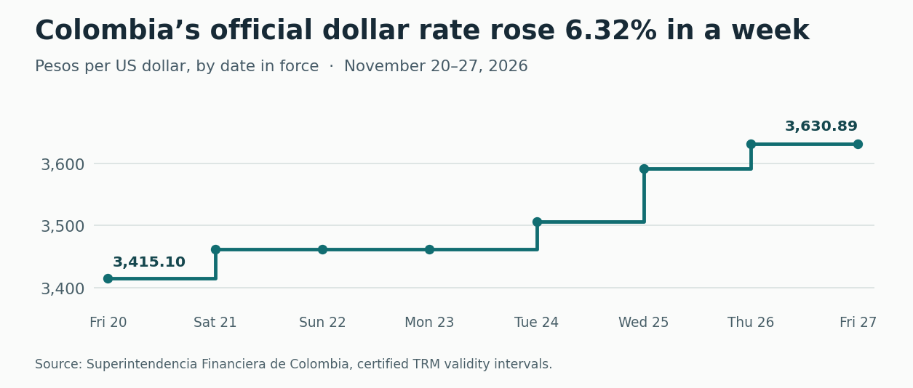

# November 27 weekly review

The weekly brief closed at 10:44 a.m. Bogotá time on November 27, 2026. The desk verified the following official records after that cutoff.

**Supplementary budget.** Congress approved about COP 3.8 trillion in added funding and COP 1.47 trillion in reallocations. The Senate approved the bill November 24. The House approved it November 25 and lists Acta 031. About COP 1.1 trillion of the addition goes to Colombia Mayor. Prosperidad Social identified presidential sanction and budget procedures as the next steps. This review found no verified payment date. [House bill record](https://www.camara.gov.co/modificacion-del-presupuesto-general-de-la-nacion/) · [Prosperidad Social, November 25](https://prosperidadsocial.gov.co/Noticias/congreso-aprueba-11-billones-de-pesos-en-transferencias-monetarias-para-el-programa-colombia-mayor-de-prosperidad-social/)

**Exchange rate.** The official certification for COP 3,630.89 per US dollar covers November 26 and 27. Against the November 20 rate of COP 3,415.10, the Friday-to-Friday increase is 6.32%. The 4.9% in the morning brief starts on Saturday the 21st. The 9.14% uses Thursday the 19th as its base. [Official TRM series](https://www.datos.gov.co/Econom-a-y-Finanzas/Tasa-de-Cambio-Representativa-del-Mercado-TRM/32sa-8pi3)

**Pensions.** Decree 1815 changes the assumptions insurers use to price and reserve for covered annuities. Through December 31, insurers and policyholders can agree to adjust old-age and deferred old-age policies priced under Decree 1485 of 2025. Adjustments must protect the pensioner and beneficiaries. [Diario Oficial 53.703, pages 3–6](https://svrpubindc.imprenta.gov.co/diario?edicion=53.703)
